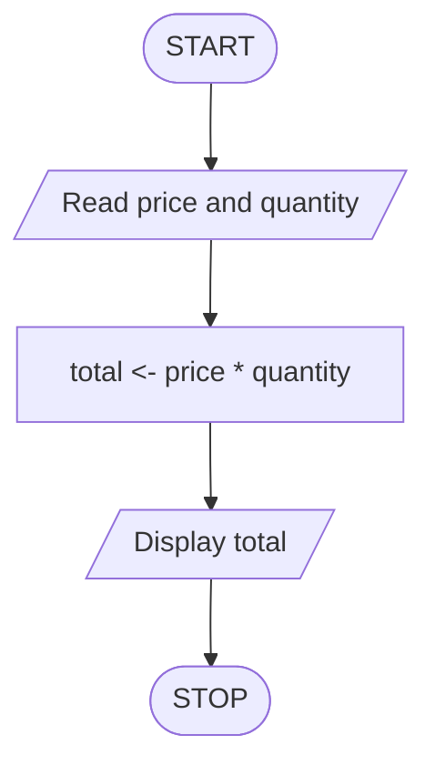

NIM: 1001260003  
Nama: Indrawan Lisanto  
Prodi: Sistem Informasi

# Individual Assignment 1

## Simple Shopping Bill

### 1. Case Narrative

A customer buys several items of the same type and price. The cashier needs
to calculate the total amount that the customer must pay. The calculation is
simple: multiply the price of one item by the number of items purchased.

This algorithm does not include a discount, tax, or additional charge. The
price must be zero or greater, and the quantity must be a positive whole
number.

### 2. Input, Process, and Output

| Part | Description |
| --- | --- |
| Input | `price`: price of one item; `quantity`: number of items purchased |
| Process | Calculate `total = price * quantity` |
| Output | `total`: the amount that the customer must pay |

### 3. Narrative Representation

1. Start.
2. Read the price of one item.
3. Read the number of items purchased.
4. Multiply the price by the quantity to calculate the total.
5. Display the total amount to pay.
6. Stop.

### 4. Pseudocode Representation

```text
ALGORITHM SimpleShoppingBill

    DECLARE price, total AS number
    DECLARE quantity AS integer

    START
        READ price
        READ quantity
        total <- price * quantity
        DISPLAY total
    STOP

END ALGORITHM
```

### 5. Flowchart Representation

The flowchart uses the following standard symbols:

- **Oval**: start or stop
- **Parallelogram**: input or output
- **Rectangle**: process
- **Arrow**: direction of flow

```text
              ( START )
                  |
                  v
        / Read price and quantity /
                  |
                  v
          [ total <- price * quantity ]
                  |
                  v
            / Display total /
                  |
                  v
               ( STOP )
```

The same flow is represented below in Mermaid notation for a graphical
rendering:



### 6. Test with Sample Data

#### Test Case

| Variable | Value |
| --- | ---: |
| `price` | Rp 25,000 |
| `quantity` | 4 |

#### Trace of Execution

1. The algorithm reads `price = Rp 25,000`.
2. The algorithm reads `quantity = 4`.
3. It calculates:

   ```text
   total = price * quantity
         = 25,000 * 4
         = 100,000
   ```

4. It displays `Rp 100,000`.

#### Result

```text
Input:
  price = Rp 25,000
  quantity = 4

Output:
  total = Rp 100,000
```

The result is correct because four items priced at Rp 25,000 each cost
Rp 100,000 in total.

### 7. Conclusion

The solution is a finite sequence of ordered steps. The narrative explains
the algorithm in everyday language, the pseudocode expresses the same logic
using structured text, and the flowchart expresses it using connected
symbols. All three representations preserve the same input, calculation, and
output. The trace with sample data confirms that the algorithm produces the
expected result.

